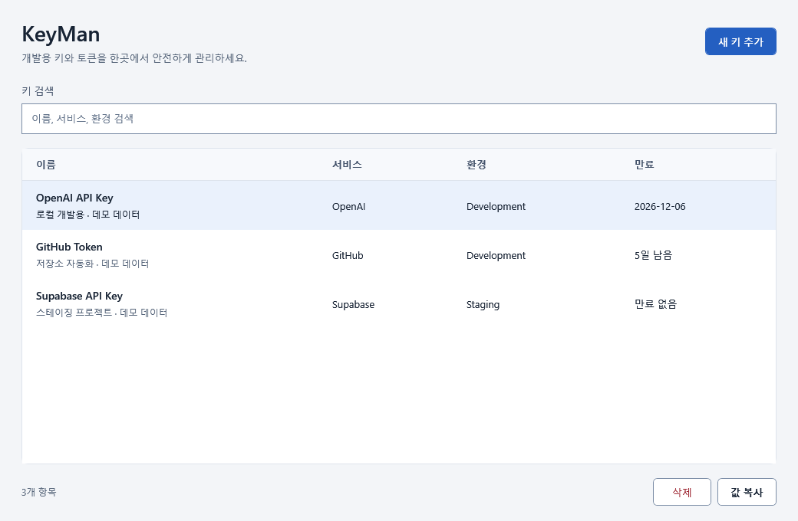
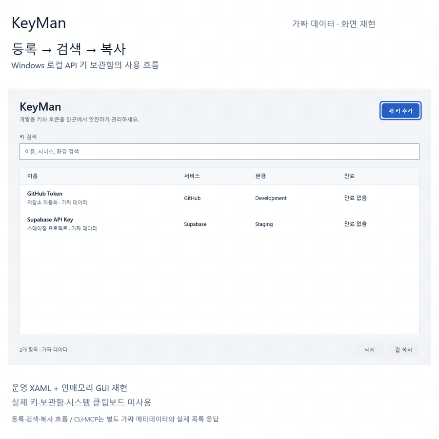

# KeyMan

[](https://github.com/jaywapp/key-man/actions/workflows/verify-windows.yml)

**API 키를 찾을 때마다 `.env`를 뒤지지 않도록.**

여러 프로젝트에 흩어진 개발용 키를 한곳에서 찾고 사용하세요. KeyMan은 **Windows 개발자를 위한 로컬 API 키·토큰 보관함**입니다. 실제 값은 Windows 자격 증명 관리자에 저장합니다.

| GUI로 정리 | CLI로 연결 | MCP로 요청 |
|---|---|---|
| 서비스·환경별 검색, 만료일 확인, 값 숨김 복사 | 숨김 입력·stdin 등록, 스크립트에서 사용 | Claude Code·Codex에서 목록·등록·복사 요청 |

> **[v1.1.0-alpha.1](https://github.com/jaywapp/key-man/releases/tag/v1.1.0-alpha.1) 알파** — Clear Desk 화면과 저장 안정성 개선을 담았습니다. Windows x64용 개발·평가 버전이며 설치 파일은 코드 서명되지 않았습니다.

[Windows 설치 파일 다운로드](https://github.com/jaywapp/key-man/releases/download/v1.1.0-alpha.1/KeyMan-Setup-1.1.0-alpha.1.exe) · [SHA-256 체크섬](https://github.com/jaywapp/key-man/releases/download/v1.1.0-alpha.1/KeyMan-Setup-1.1.0-alpha.1.exe.sha256) · [릴리스 안내](https://github.com/jaywapp/key-man/releases/tag/v1.1.0-alpha.1)

**바로 사용:** Windows x64 설치 파일에는 런타임이 포함됩니다. **직접 개발:** Windows와 .NET 10 SDK로 [소스에서 실행](#소스에서-실행)하세요.

소스와 설치 파일은 로그인 없이 볼 수 있습니다. 피드백 이슈와 비공개 보안 제보에는 GitHub 로그인이 필요합니다.



현재 앱의 XAML을 가짜 데이터로 렌더링한 화면입니다. 실제 사용자 키는 포함하지 않습니다.

<details>
<summary>26초 데모: 등록 → 검색 → 복사 → CLI·MCP 목록</summary>



운영 XAML과 가짜 모델로 만든 화면 재현입니다. 실제 자격 증명 저장·클립보드 복사를 촬영한 영상은 아닙니다. CLI·MCP 목록은 별도 fixture의 실제 응답을 사용합니다. [정사각 MP4](docs/assets/demo/keyman-threads-square.mp4) · [정적 이미지](docs/assets/demo/keyman-demo-poster.png) · [데모 범위와 재생성](docs/demo.md)

</details>

## 이런 흐름에 맞습니다

- 여러 서비스의 개발용 키를 이름·서비스·환경·만료일로 관리합니다.
- GUI에서 값을 화면에 드러내지 않고 복사합니다.
- CLI에서 값을 받아 필요한 로컬 프로세스에 전달합니다.
- Codex·Claude Code에서 키 이름으로 작업을 요청합니다. **KeyMan MCP 도구 결과에는 비밀값을 반환하지 않습니다.**

클라우드 계정 없이 현재 Windows 사용자 범위에서 동작합니다. 팀 공유, 클라우드 동기화, 키 발급·자동 회전 기능은 제공하지 않습니다.

## 설치와 첫 키 등록

릴리스의 `KeyMan-Setup-1.1.0-alpha.1.exe`와 SHA-256 체크섬을 확인한 뒤 설치합니다. 설치 파일은 Windows x64용이며 .NET 런타임을 포함합니다. 서명·검증 환경·업데이트 안내는 [설치 문서](docs/installer.md)를 확인하세요.

1. 시작 메뉴에서 KeyMan을 실행합니다.
2. 추가 화면에서 이름 `Sample`, 서비스 `Demo`, 환경 `Development`와 테스트용 값을 입력합니다.
3. 목록에서 `Demo`를 검색하고 복사합니다. 만료일을 지정하면 만료 상태도 확인할 수 있습니다.

**GUI와 MCP는 30초 뒤 또는 정상 종료 시 자신이 복사한 클립보드의 정리를 시도합니다. CLI `copy`는 자동으로 지우지 않습니다.** 이후 복사한 다른 내용은 지우지 않습니다. 클립보드가 사용 중이면 정리에 실패할 수 있으며, 기록·클라우드 동기화 사본과 강제 종료까지 삭제를 보장하지 않습니다.

## CLI

설치 후 새 터미널에서 다음 명령을 사용할 수 있습니다. 비밀값 인수를 생략하면 숨김 입력을 받습니다.

```powershell
key-man.exe register "ScriptSample" --service Demo --environment Development
key-man.exe list Demo
key-man.exe copy "ScriptSample" --service Demo --environment Development
```

`key-man.exe get "Sample"`은 **비밀값을 표준 출력으로 반환**합니다. 터미널·대화·로그로 출력하지 않도록 직접 제어하는 스크립트에서 사용하세요. 옵션, stdin 등록, 종료 코드는 [CLI 문서](docs/cli.md)에 있습니다.

## MCP

로컬 stdio 서버 `key-man-mcp.exe`가 GUI·CLI와 같은 보관함을 사용합니다. “Demo 서비스의 키 목록을 보여줘”, “Sample을 클립보드로 복사해줘”처럼 요청할 수 있습니다. 등록할 값은 대화에 붙여 넣지 않고 로컬 클립보드 또는 서버가 상속한 환경 변수에서 읽습니다. [Codex·Claude Code 연결 방법](docs/mcp.md)을 참고하세요.

MCP 결과에 값을 싣지 않는 것은 **AI나 같은 사용자 권한의 프로그램으로부터 비밀값을 격리한다는 뜻이 아닙니다.** 셸 접근이 가능한 에이전트는 CLI `get` 등을 실행할 수 있습니다. 클립보드·환경 변수도 같은 사용자 권한의 다른 프로그램이 읽을 수 있습니다. 권한과 도구 승인은 사용하는 AI 클라이언트에서 관리해야 합니다.

## 저장 위치와 보안

| 데이터 | 위치 |
|---|---|
| 실제 API 키·토큰 | 현재 Windows 사용자의 자격 증명 관리자, `KeyMan/<id>` |
| 이름·서비스·환경·메모·만료일 등 | `%LOCALAPPDATA%\KeyMan\vault.json` |

메타데이터는 평문입니다. 이름이나 메모에 비밀값을 넣지 마세요. JSON 파일만 복사해서는 비밀값을 백업하거나 다른 PC로 옮길 수 없습니다. 앱 제거 후에도 사용자 데이터는 보존됩니다. 삭제·제보·위협 모델은 [보안 정책](SECURITY.md)을 참고하세요.

## 소스에서 실행

Windows와 .NET 10 SDK가 필요합니다.

```powershell
dotnet build .\KeyMan.sln -c Release
dotnet run --project .\src\KeyMan\KeyMan.csproj
dotnet run --project .\src\KeyMan.Cli\KeyMan.Cli.csproj -- --help
```

기존 `.env`를 가져오려면 [CLI 문서의 가져오기 안내](docs/cli.md)를 먼저 확인하세요. 이 기능은 원본 `.env`를 삭제하지 않습니다.

## 문서와 피드백

- [설치·업데이트·제거](docs/installer.md)
- [CLI 사용법](docs/cli.md) · [MCP 연결](docs/mcp.md) · [아키텍처](docs/architecture.md)
- [기여 안내](CONTRIBUTING.md) · [보안 정책](SECURITY.md) · [문서 목록](docs/README.md)

알파 피드백은 [GitHub 이슈](https://github.com/jaywapp/key-man/issues/new/choose)에 남겨 주세요. 사용한 버전, Windows 버전, 실행 경로(GUI/CLI/MCP), 재현 과정을 적고 실제 키·토큰·`.env`·개인 보관함 파일은 첨부하지 마세요. 보안 문제는 공개 이슈 대신 [보안 정책](SECURITY.md)을 따릅니다.

2026-11-06 기준 자동 테스트·설치 검증을 통과했습니다. [검증 환경·결과·미검증 범위](docs/verification.md)에서 실제 CI 근거를 확인할 수 있습니다.

KeyMan은 [MIT 라이선스](LICENSE)를 따릅니다. 설치 폴더의 `LICENSE.txt`에 원문을 포함하며, 외부 구성요소의 라이선스·고지는 `ThirdPartyNotices`에 있습니다.
