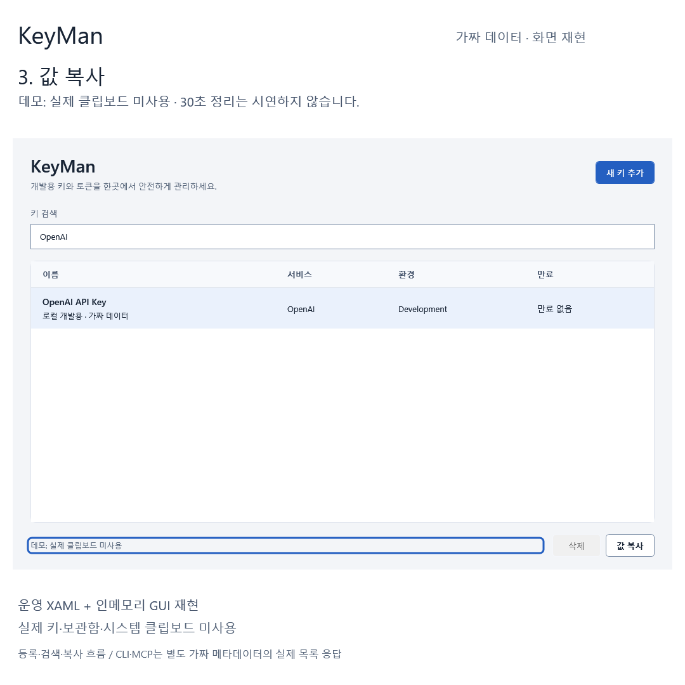

# KeyMan 데모 미디어

운영 WPF XAML과 가짜 데이터로 **등록 → 검색 → 복사** 흐름을 재현한 26초 소개 자료다. 데스크톱을 녹화한 영상이나 실제 비밀값의 저장·클립보드 동작을 검증한 영상이 아니다. 영상 전체에 “가짜 데이터 · 화면 재현”을 표시한다.

## 파일

| 파일 | 형식과 용도 | 검증 결과 |
|---|---|---|
| [데모 GIF](assets/demo/keyman-demo.gif) | 900×900, 반복 재생, 무음 | 26초, 104프레임, 242,029바이트 |
| [Threads 정사각 영상](assets/demo/keyman-threads-square.mp4) | 1080×1080, H.264, yuv420p, 30fps, 무음, faststart | 26초, 780프레임, 280,913바이트 |
| [정적 이미지 폴백](assets/demo/keyman-demo-poster.png) | 1080×1080 PNG, 복사 흐름의 정적 장면 | 56,123바이트 |
| [실제 fixture 응답과 소스 해시](assets/demo/fixture-evidence.json) | CLI·MCP 응답, 장면 순서, 운영 XAML SHA-256 | 비밀값 없이 메타데이터만 기록 |
| [코덱·크기 검사](assets/demo/media-verification.json) | ffprobe 검사 원본 요약 | GIF·MP4 길이·해상도 확인 |



애니메이션을 재생할 수 없는 환경에서는 정적 이미지를 사용한다. 대체 텍스트: “KeyMan에서 가짜 OpenAI 항목을 검색·선택하고 복사 동작을 재현한 화면. 실제 클립보드는 사용하지 않음.”

## 보여 주는 범위

| 구간 | 내용 | 실행 범위 |
|---|---|---|
| 0–3초 | 가짜 항목이 있는 보관함과 새 키 추가 | 운영 MainWindow XAML의 렌더링 |
| 3–9초 | 이름·서비스·환경·가짜 비밀값 입력 | 운영 추가 창 XAML + 인메모리 폼 바인딩 |
| 9–12초 | 등록한 가짜 항목 표시 | 메모리 목록만 변경. 자격 증명 저장 안 함 |
| 12–15초 | `OpenAI` 검색 | 인메모리 목록의 검색 바인딩 |
| 15–22초 | 선택·값 복사 | 가짜 복사 명령과 상태 표시. 실제 클립보드 미사용 |
| 22–26초 | CLI·MCP 목록 응답 예시 | 별도 fixture JSON을 읽는 실제 CLI·MCP 프로세스 응답 |

화면은 `src/KeyMan/App.xaml`, `MainWindow.xaml`, `AddCredentialWindow.xaml`을 읽어 렌더링한다. 실제 앱 생성자와 저장·복사 핸들러를 실행하지 않도록 `x:Class`와 `PasswordChanged` 이벤트 연결을 제거하고 별도 인메모리 모델을 바인딩한다. 입력·검색·명령 바인딩을 확인한 뒤 프레임을 생성하며, 강조 테두리와 캡션은 데모 도구가 합성한다. 마우스·키보드를 실시간 녹화한 장면으로 소개하지 않는다.

CLI는 `key-man.exe list OpenAI --json`, MCP는 `keyman_list`에 `query=OpenAI`를 전달한다. 도구가 만든 별도 메타데이터 JSON만 `KEYMAN_VAULT_PATH`로 지정하고 실제 응답을 캡션으로 표시한다. CLI·MCP 등록·조회·복사·삭제 도구는 호출하지 않는다. MCP `keyman_list`의 조회는 메타데이터 목록 조회이며 비밀값 조회가 아니다.

Windows 자격 증명 저장소의 비밀값 읽기·쓰기·삭제, 사용자 보관함 파일 읽기, 시스템 클립보드 읽기·쓰기는 수행하지 않는다. 30초 정리 동작·제공업체 연결·실제 키 유효성은 시연하지 않는다. 영상의 성공 상태를 해당 보안 기능의 검증 근거로 사용하지 않는다.

## 다시 생성

Windows, .NET 10 SDK, `ffmpeg`, `ffprobe`가 PATH에 있어야 한다. PowerShell 5.1에서도 실행할 수 있다.

```powershell
& .\tools\Build-Demo.ps1
```

스크립트는 별도의 [WPF 데모 프로젝트](../tools/KeyMan.Demo/KeyMan.Demo.csproj)와 CLI를 Release로 빌드한다. 1080×1080 PNG 104개를 `artifacts/demo/frames/`에 만들고, ffmpeg로 GIF와 MP4를 인코딩한다. 중간 프레임과 가짜 JSON은 Git에서 제외된 `artifacts/`에 남으며 공개 미디어는 `docs/assets/demo/`에 덮어쓴다. 해당 경로에 개인 자료를 두지 않는다. 인코더·폰트·운영체제 버전이 달라지면 파일 바이트 수와 해시는 달라질 수 있다.

목록 응답 수집은 30초 제한을 사용한다. GUI 등록·검색·복사 명령, 기대 목록 수, CLI·MCP 응답 내용, 인코딩 종료 코드, 최종 길이 15–30초를 검사하며 실패하면 생성을 중단한다. 현재 빌드 환경에서는 다중 MSBuild 노드가 실패하여 재현 스크립트에 단일 노드 `-m:1 -nr:false`를 사용한다.

## 검증 기록

2026-11-06 Windows 환경에서 생성했다. 운영 XAML의 필드·명령 바인딩으로 가짜 등록·검색·복사를 확인했고, CLI·MCP 실제 목록 응답을 저장했다. 등록·검색·복사·응답 장면의 대표 프레임을 시각 검토하여 캡션 잘림과 실제 키·개인 경로 노출이 없음을 확인했다. ffprobe로 두 파일의 해상도·길이·코덱을 확인하고 MP4 전체 디코딩 검사도 통과했다.

데모 프로젝트 빌드는 오류 0개이며 NuGet 취약성 피드 접속 실패로 `NU1900` 경고가 발생했다. 이는 새 취약성 검사가 성공했다는 뜻이 아니다. CLI 빌드는 경고·오류 0개였다. Threads 실제 업로드·재생과 GitHub 익명 접근은 검증하지 않았다.
